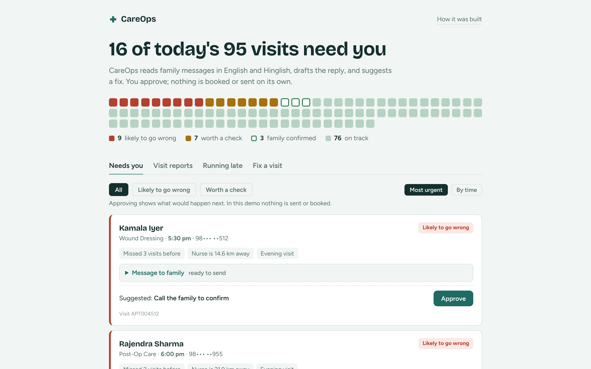
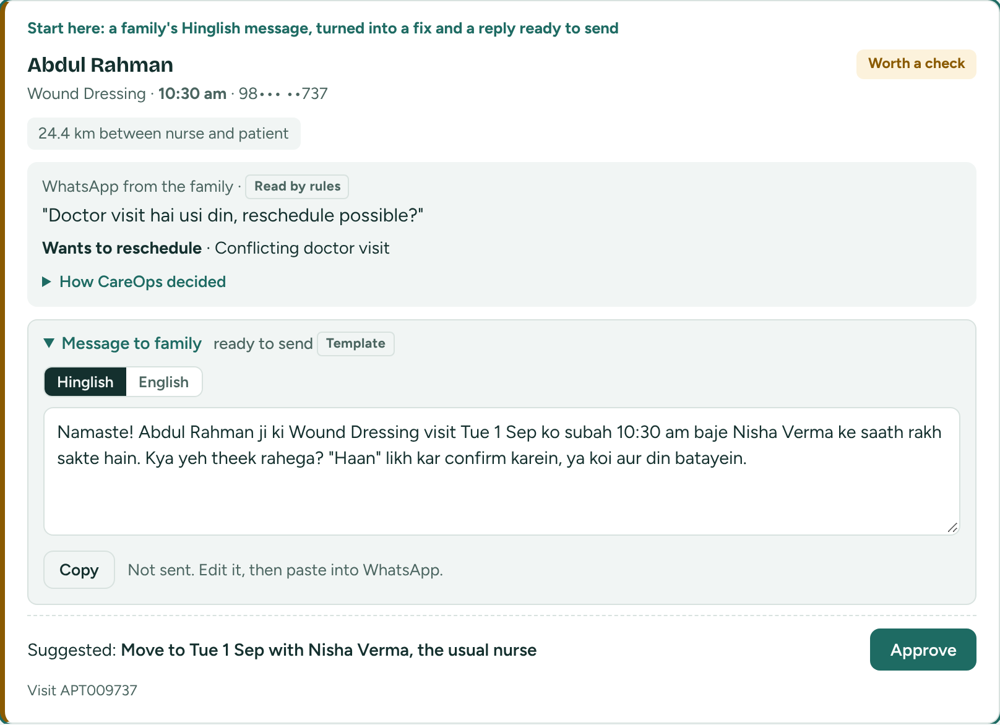
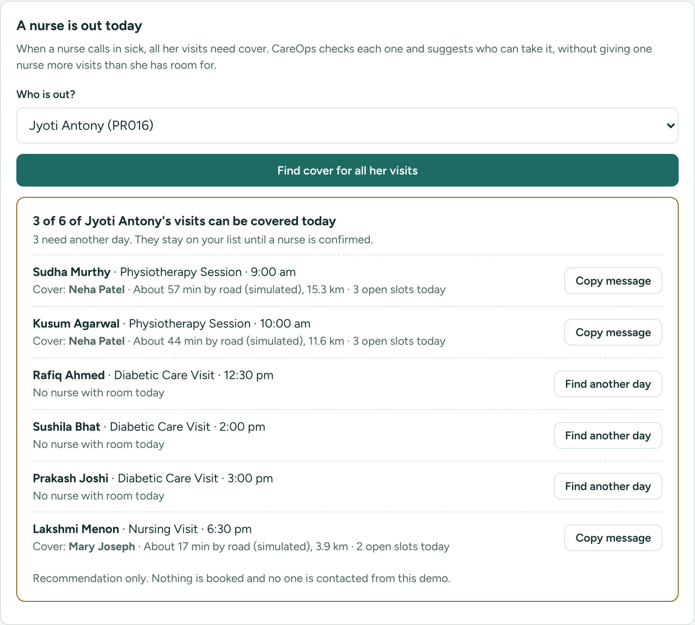
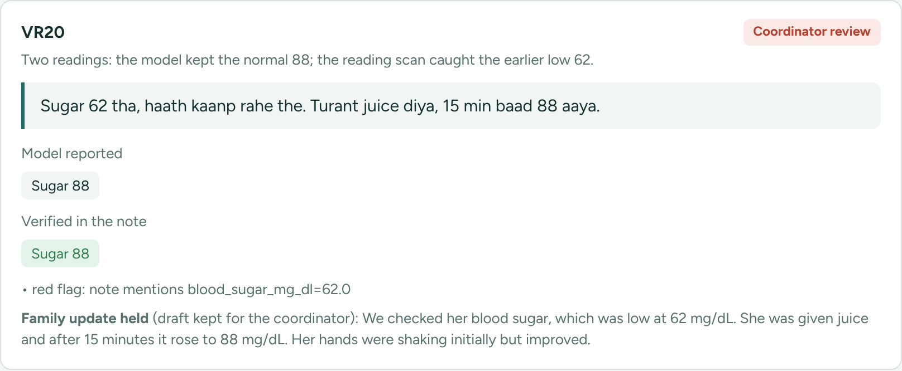
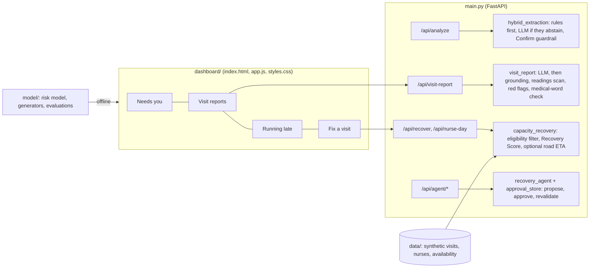

# CareOps — AI operations copilot for home healthcare

**When a home-care visit is about to fail, CareOps reads the family's message, finds a safe replacement provider, and drafts the fix — then waits for a human coordinator to approve it.**

Built for the realities of India's home-care market: contractual providers with day-to-day availability, families who message in English, Hindi and Hinglish, and elderly patients who can't afford a missed visit.

**Live demo: [https://careops-live-demo-18xj.onrender.com/](https://careops-live-demo-18xj.onrender.com/)** (free hosting, so the first load can take up to a minute)

> All data is synthetic. This is a product portfolio project: it shows problem framing, evaluation and AI-product judgment, not production outcomes.

**Short on time? Read the [one-page case study](docs/CASE_STUDY.md)**: the problem, key product decisions, results and what I learned.



**[Watch the 70-second walkthrough](docs/media/careops-demo.mp4)** (or the [38-second version](docs/media/careops-demo-short.mp4)): a Hinglish reschedule with a ready-to-send reply, a nurse running late, cover for a nurse who is out sick, and visit reports that hold unsafe updates for review.

<details>
<summary>Example: a Hinglish message becomes a proposed fix and a reply ready to send</summary>



</details>

<details>
<summary>Example: a nurse calls in sick, and CareOps suggests cover for all her visits</summary>



</details>

<details>
<summary>Example: the safety layer catching what the model missed</summary>



</details>

---

## How it works

```
Family message ──► Understand ──► Find recovery options ──► Propose ──► Coordinator approves
"aaj nahi aa       rules first,     hard eligibility filter,   draft fix    nothing is booked or
 payenge, kal?"    LLM only when    then a weighted Recovery    + reasons    sent without a human
                   rules abstain    Score (continuity, ETA,
                                    capacity, slot fit, load)
```

| Step | What it does | Why it's built this way |
|---|---|---|
| **Understand** | Extracts intent, requested day, reason and whether the current visit is being dropped | Rules are free and instant, so the LLM is called only when they abstain. A deterministic guardrail can send any Confirm to a human; anything unclear escalates instead of guessing |
| **Recover** | Ranks eligible replacement providers with a plain-language "why", using road travel time when routing is on | Service fit is a hard filter, not a score, so an ineligible provider can never win on proximity; a straight-line estimate is never shown as a road ETA |
| **Approve** | Persists every proposal and decision with an audit trail | High-stakes actions stay human; the agent fails closed on errors |

## What changed after coordinator walkthroughs

I walked through the product as five coordinator personas (field coordinator, elder-companionship coordinator, hospital clinical lead, night-shift coordinator, agency owner). It surfaced three trust-breaking issues and a mismatch with how coordinators work. All are fixed:

| Found | Fix |
|---|---|
| Approving a visit with no backup nurse said "Marked as handled" | It now says "Escalated · unassigned" and stays on the list |
| A reschedule told the nurse about the booking before the family agreed | The slot is held quietly; the nurse is told only after the family says yes |
| Visits the family had already confirmed still sat in "needs attention" | Moved to a separate "Already confirmed" group; the headline counts only open visits |
| IDs (APT004512, PR019) and "Evening slot" instead of people and times | Synthetic patient and nurse names, exact times, masked phone numbers |
| Every suggestion still needed a hand-typed WhatsApp message | An editable Hinglish/English message is drafted for each action (templates, never sent automatically) |
| "No suitable replacement found. Contact the operations lead." | Next-best options: find the next day with a free nurse, a message asking the family to move |
| BP 170/100 was not called out; system text such as "external LLM calls are disabled" reached the coordinator | Every reading in the note is shown as usual, outside the usual range, or red flag; reasons are in plain words |

A second round with ten reviewers (recruiter, senior PM, AI PM interviewer, engineer, data scientist, designer, agency founder, NRI family member, nurse, doctor) added: a "nurse is out today" flow that covers all her visits, a "family said yes / no" step, what the family actually sees (queued for their morning if they live abroad), a message back to the caregiver when a note is held, an owner's staffing-gap view, an on-screen action history, [cited thresholds](docs/THRESHOLDS.md), a check that family updates never add medical words the caregiver did not use, an accessibility pass, confidence intervals and a calibration plot.

A third pass separated the two audiences on one page. Visitors see the portfolio framing (banner, pitch, "where AI is used"). **"See the coordinator's view"** hides all of it and leaves what an operator needs first: "16 of today's 95 visits need you · 2 families wrote in · 6 visits have no backup nurse · 3 nurses running late", each a shortcut to those visits. Finished work moves to "Done today" and the counts update. Working a full simulated morning end to end added the rest: acted-on visits drop into "Waiting on someone else" so the headline counts only what still needs action, reminders can be closed ("Family confirmed" / "No reply"), and progress survives a page refresh.

These are simulated personas, so they are hypotheses to test with real coordinators ([testing kit](docs/USER_TESTING.md)), not evidence.

## Results (synthetic, author-labelled data)

**Message understanding: real API runs on Groq's free tier** ([full write-up](docs/LLM_EVALUATION.md))

| On a fresh 39-message holdout, frozen before the final prompt existed | Accuracy | 95% interval ² | False confirmations |
|---|---|---|---|
| Rule-based parser alone (103-message set) | 53.4% | 44–63% | — |
| gpt-oss-120b, prompt v1 (labels not defined) | 76.9% | 62–87% | 0 |
| gpt-oss-120b, prompt v2 (labels defined) | 94.9% | 83–99% | 2 |
| gpt-oss-120b, prompt v3 (Confirm rule fixed) | **97.4%** | 87–99.5% | 1 |
| gpt-oss-120b, prompt v3 + deterministic Confirm guardrail | **100%** ¹ | — | **0** |

- **The prompt fix created a worse error.** Defining the labels lifted accuracy from 77% to 95%, but introduced false confirmations ("Thanks." read as "visit confirmed"). A targeted v3 fixed most of them; a guardrail that can only ever send a Confirm to a human removed the rest. Across all 10 saved runs, false confirmations went from 8 to 0, at the cost of one extra human review per 103 messages.
- **The smaller model looked as good, until fresh data said otherwise.** gpt-oss-20b matched 120B on the first two sets, then fell to 92.3% on the clean one, including reading "Monday rakh lo" (move it to Monday) as Confirm.
- About 1.2 s per message (p50) and ₹0 spent.

¹ The guardrail's rules were motivated by errors on this set, so its 100% is optimistic until measured on a new holdout.
² Wilson 95% intervals (`python model/confidence_intervals.py`). With 39 messages, one error moves accuracy by 2.6 points, so the intervals are wide: v3 is clearly better than v1, but v2 and v3 overlap. All labels are by one person; `model/labeller_agreement.py` measures agreement once a second person labels the same messages.

**Voice visit reports** ([write-up](docs/VISIT_REPORTS.md)): a caregiver's voice note becomes a structured report and a family update, via free Whisper and an LLM, with deterministic checks after the model. On 30 Hinglish notes with gpt-oss-120b:

- **0 invented vitals** and **0 wrong or invented vitals reaching a family**; 100% of notes that need a coordinator are flagged.
- **The real run found a gap the perfect-model test could not:** "Sugar 62 … later 88": the model reported only the normal reading, so the first version would have released a cheerful update after a low-sugar episode. Now every reading in the note is scanned, whatever value the model picked.
- **The model misread spoken Hindi numbers** ("sattanve", 97, became 100). Grounding held both such notes for review, which turned an apparent cost (18% of routine notes reviewed) into a measured benefit.

**Rest of the system**

| What was measured | Result |
|---|---|
| Recovery agent on a frozen 30-case holdout (offline rules path) | **25/30** correct dispositions, **0** false cancellations, all 5 proposals passed revalidation |
| Disruption-risk model after fixing a data-leakage bug | ROC-AUC fell from 0.658 to **0.58**, reported honestly rather than kept inflated. Its probabilities track observed rates ([calibration plot](docs/media/calibration.png)) but add little over the base rate (Brier 0.188 vs 0.191), so it is only a "look here first" ranking, not a verdict |

## What I'd change next

- Test with 3 to 5 real coordinators and measure time to resolve a disrupted visit ([testing kit](docs/USER_TESTING.md)).
- Get a second person to label the holdouts and report agreement (`model/labeller_agreement.py`).
- Add companion visits to the daily list (today they appear only in visit reports), and a weekly outcomes view for owners.
- Define `cancel_current` operationally: most of the model's "errors" on it are a labelling ambiguity, not model mistakes.
- Measure the guardrail on a third holdout frozen before any further change.
- Run the road-ETA comparison live: routing is built in (`CAREOPS_ROUTING_MODE=live`, Ola Maps), but whether real roads change the recommended provider is not yet measured.
- Calibrate the risk model for first-time patients, where it is overconfident (+8.6-point calibration gap on a small subgroup).

**Out of scope on purpose:** emergency response, night-time alerts and billing. CareOps is a daytime planning and follow-up tool for coordinators.

## Try it

```bash
git clone https://github.com/Ritikajaiswal2707/careops.git && cd careops
pip install -r requirements.txt
uvicorn main:app --reload          # open http://127.0.0.1:8000
python -m pytest -q                # full test suite
```



The dashboard's main views show a **precomputed synthetic snapshot**; the "Fix a visit" and "Visit reports" tabs call the live FastAPI backend. Patient and nurse names, visit times and phone numbers are synthetic, derived from the IDs. The approval animation is a **browser-side simulation**: nothing is booked or sent. The [live demo](https://careops-live-demo-18xj.onrender.com/) is a read-only deployment (`render.yaml`) with external LLM calls disabled: approvals cannot be recorded, and visit reports fail closed to coordinator review while still running the deterministic red-flag checks. Verified locally on 12 November 2026: all tabs load without page errors, keyboard navigation works, and an automated WCAG 2 AA scan (axe-core) reports no violations.

## How this was built

I defined the problem, users, product decisions, evaluation design and safety rules, and reviewed every change. The code was written with Claude as an AI pair programmer.

## Go deeper

- [Technical deep dive](docs/DEEP_DIVE.md) — every module, evaluation, bug found and limitation
- [PRD](docs/PRD.md) · [Product decisions](docs/PRODUCT_DECISIONS.md) · [Roadmap](docs/PRODUCT_ROADMAP.md) · [Experiment design](EXPERIMENT_DESIGN.md)
- [Agent evaluation](docs/AGENT_EVALUATION.md) · [Parser safety audit](docs/PHASE13_EVALUATION.md) · [Approval lifecycle](docs/APPROVAL_LIFECYCLE.md)
- [Visit-report thresholds and their sources](docs/THRESHOLDS.md) · [How it would plug into WhatsApp and Sheets](docs/INTEGRATIONS.md) · [Risk-model calibration plot](docs/media/calibration.png)
